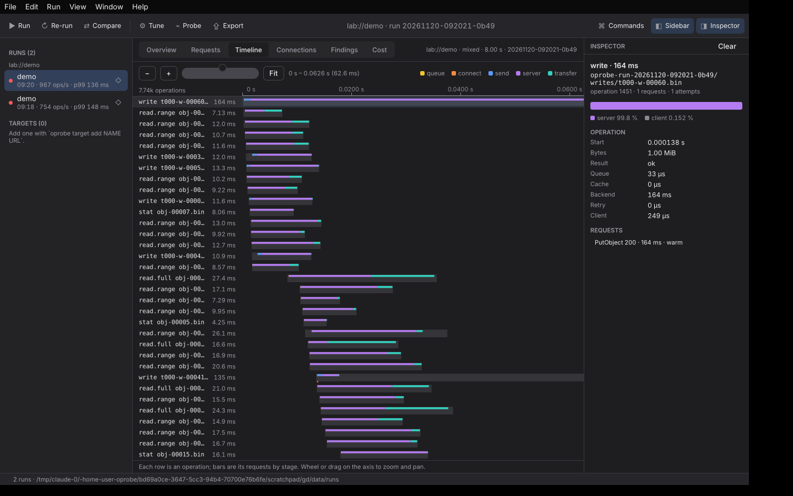

# oprobe

**See which layer makes your object-storage I/O slow or expensive — then fix it.**

`oprobe` drives realistic workloads through [Apache OpenDAL](https://opendal.apache.org/) against
S3, GCS, Azure Blob, R2, OSS, COS, B2, MinIO or local storage and traces **every backend request**
at the transport level: time spent queued, DNS/TCP/proxy/TLS on fresh connections, sending the
request, waiting for the first byte, transferring the body, and waiting for your code to consume
it. It then tells you where the time and the money go, finds the best client configuration
without tripping 429/503 throttling, and turns it all into a CI regression gate.

[中文文档](README.zh-CN.md) · [Desktop app](docs/app.md) · [Metrics & methodology](docs/metrics.md) · [Workloads & profiles](docs/workloads.md) · [Tuning](docs/tuning.md) · [CI gate](docs/ci.md) · [Cost model](docs/cost.md) · [Troubleshooting](docs/troubleshooting.md)

```text
$ oprobe run s3://noaa-ghcn-pds --anonymous --existing csv.gz/ --preset mixed -d 8s -c 8

[REVIEW] Server latency (TTFB)-bound: 84% of operation time is spent in server latency (TTFB) (p50 64.6ms / p99 218ms).

  throughput 98.4 ops/s · 77.8 MiB/s   latency p50 64.6ms · p99 218ms · p99.9 1.51s   errors 0 · 0 throttled

WHERE THE TIME GOES  (share of operation wall time)
  connect   ▊                              2.1%  DNS + TCP + proxy + TLS on fresh connections
  server    ████████████████████████████  83.5%  time to first byte (server processing + RTT)
  download  ████▊                         14.2%  receiving response bodies

BACKEND REQUESTS  (mean per request; p99 of total)
  request     count  warm   queue  connect    send    ttfb  transfer   stall     p99   status
  GetObject     747   99%  0.01ms    338ms  0.00ms  81.7ms    15.0ms  0.00ms   342ms  206×747
  HeadObject    116  100%  0.01ms        -  0.00ms  43.0ms    0.02ms  0.00ms  62.2ms  200×116

SLOWEST OPERATION
  read.full 1.51s at 3.3s  queue 0.00ms · backend 1.51s · client 1.04ms
    #3  +0.16ms  GetObject  206 h1 conn#31 cold  connect 335ms (proxy 274ms tls 60.6ms) · ttfb 164ms · transfer 242ms  req-id WKPW2FKWB2K5RH9X
    #4  +0.18ms  GetObject  206 h1 conn#30 cold  connect 352ms (proxy 273ms tls 78.4ms) · ttfb 163ms · transfer 283ms  req-id WKPP3FEWN4DYN946
    async call stack captured while in flight:
      read.full [128.000ms]
        [sub-task 5] opendal::background_task → GetObject
```
*(real output, trimmed: AWS S3 from a cloud VM through an egress proxy, OpenDAL's default HTTP client)*

## Workbench: window and terminal

Run `oprobe` with no arguments and its workbench opens — a native window (AppKit on macOS, Win32/Direct2D on
Windows, GTK 4 on Linux) when there is a display, the same UI in your terminal otherwise (`oprobe top`, also over
SSH). Run, tune and probe from forms; watch live charts; inspect the slowest operation as a request waterfall.
[More →](docs/app.md)

Two layers, no other frameworks: **OpenDAL and its own HTTP client, observed request by request** for everything
that measures, and **[Native Shell (NSH)](https://github.com/longbridge/nsh)** for everything you look at.



## Why oprobe

Black-box benchmarks report "120 MiB/s, p99 280 ms" and leave you guessing. oprobe answers the
next questions directly from measurements — never from estimates:

| Question | How oprobe answers it |
|---|---|
| Is it the network, the server, or my client? | Every operation's wall time is split into **queue / connect / upload / server TTFB / download / client** using the real request timeline ([how](docs/metrics.md)). |
| Why is p99 so much worse than p50? | The slowest operations are kept with **every backend request's stage timings, connection (cold/warm), status, request ID** and an **async call stack** captured while they were stuck. |
| Are connections reused? Is TLS or the proxy slow? | Per-dial DNS / TCP / proxy CONNECT / TLS histograms, ALPN, TLS version, cipher, reuse ratio, peak in-flight requests. |
| Am I paying for bytes I don't use? | Logical vs backend vs wire bytes: **read amplification, over-read from range coalescing, requests per operation**. |
| What will this cost per month? | Measured request mix × provider list prices (S3, GCS, Azure, R2, B2, OSS), waste from failed/throttled requests and over-reads, savings from caching. |
| What settings should I ship? | `oprobe tune` runs real trials, **detects the 429/503 ceiling**, backs off, refines chunk/gap/parallelism/cache/HTTP version and emits a profile plus Rust/Python OpenDAL code. |
| Did my change make storage I/O worse? | `oprobe diff` compares JSON reports with noise floors and exits non-zero; Markdown for PR comments, JUnit for CI dashboards. |

## Install

| Platform | Command |
|---|---|
| Any (Rust ≥ 1.97) | `cargo install oprobe --locked` (add `--features gui` for the window on Linux) |
| macOS / Linux (Homebrew) | each release ships `oprobe.rb` for a tap — see [docs/install.md](docs/install.md) |
| macOS / Linux (script) | `curl -fsSL https://github.com/hxddh/oprobe/releases/latest/download/install.sh \| sh` |
| macOS | `oprobe-<version>-macos-universal.pkg` (command line) or `.dmg` (`oprobe.app`) — Apple Silicon + Intel |
| Debian / Ubuntu | `sudo apt install ./oprobe_<version>-1_amd64.deb` (or `_arm64`) |
| Fedora / RHEL / SUSE | `sudo dnf install ./oprobe-<version>-1.x86_64.rpm` (or `.aarch64`) |
| Windows (installer) | `oprobe-<version>-x64.msi` / `-arm64.msi` — adds `oprobe` to `PATH` and a Start menu entry |
| Windows (Scoop) | `scoop install https://github.com/hxddh/oprobe/releases/latest/download/oprobe.json` |
| Windows (PowerShell) | `irm https://github.com/hxddh/oprobe/releases/latest/download/install.ps1 \| iex` |
| Linux desktop | `oprobe-desktop-<version>-x86_64-unknown-linux-gnu.tar.gz` (window; GTK 4.14+) |

Release archives (`oprobe-<version>-<target>.tar.gz` / `.zip`) include man pages, shell completions
(bash, zsh, fish, PowerShell, elvish) and example profiles. Every asset is listed in `SHA256SUMS`.
oprobe needs no OpenSSL or system libraries at run time, and the Linux musl builds are fully static.

## Quick start

```bash
# 1. Zero setup: in-memory backend
oprobe run memory://

# 2. Reproduce storage problems locally: an S3-compatible lab with latency and throttling
oprobe lab --latency 20ms --straggler-every 50 --throttle-above 16 &
AWS_ACCESS_KEY_ID=lab AWS_SECRET_ACCESS_KEY=lab \
  oprobe run s3://bench/demo --endpoint http://127.0.0.1:9000 --proxy none -c 32

# 3. Your bucket (credentials from the usual AWS/GCP/Azure environment)
oprobe doctor s3://my-bucket/oprobe            # connectivity, TLS, clock skew, permissions
oprobe run    s3://my-bucket/oprobe --preset parquet -d 30s --json baseline.json
oprobe run    s3://my-bucket --existing warehouse/events/   # read-only, your real objects
oprobe top    s3://my-bucket/oprobe            # live workbench in this terminal

# 4. Tune and ship
oprobe tune s3://my-bucket/oprobe --preset parquet --p99-ms 250 \
  --emit-profile tuned.toml --emit-rust src/storage.rs --emit-python storage.py

# 5. Gate regressions in CI
oprobe run --profile tuned.toml --json candidate.json
oprobe diff baseline.json candidate.json --junit oprobe.xml --markdown oprobe.md
```

All test data is written under a unique `oprobe-run-<timestamp>-<id>/` prefix and deleted (and
verified deleted) when the run ends — also on errors and Ctrl-C, and when you quit the workbench
mid-run. An interrupted `oprobe run` / `oprobe tune` prints its partial results and exits with code
130. `oprobe cleanup` sweeps leftovers of killed runs.

## Commands

| Command | Purpose |
|---|---|
| `oprobe run [TARGET]` | Run a workload; print the white-box report; save `--json` / `--markdown`. `--fail-on warning\|critical` for CI. |
| `oprobe top [TARGET]` / `oprobe gui [TARGET]` | The interactive workbench in this terminal / in a window: live charts, time breakdown, per-API tables, slowest-op waterfall, tuner, probe. `oprobe` alone opens it. |
| `oprobe tune [TARGET]` | Throttle-aware closed-loop tuning with `--objective throughput\|latency\|cost`. |
| `oprobe diff BASE CAND` | Regression gate (exit code 3 on regression) with JSON / Markdown / JUnit output. |
| `oprobe doctor [TARGET]` | Step-by-step checks: config, credentials, DNS/proxy/TCP/TLS, HTTP, clock skew, list/write/read/stat/delete. |
| `oprobe probe URL` | Handshake microscope: DNS, TCP, proxy CONNECT, TLS, cold vs warm TTFB, clock skew. |
| `oprobe lab` | Local S3-compatible server (HTTP/1.1, HTTP/2, TLS 1.3) with latency, stragglers, bandwidth caps, slow multipart completion and 429/503 throttling. |
| `oprobe cleanup [TARGET]` | Remove leftovers from interrupted runs (`--dry-run`, `--older-than`, `--datasets`). |
| `oprobe init` | Print a fully commented profile for a preset. |
| `oprobe report FILE` | Re-render a saved JSON report as text or Markdown. |
| `oprobe completions SHELL` | Shell completions. |

## Workloads

Five presets model real access patterns; each can be customised with an operation mix, dataset
shape, key popularity (`uniform`, `zipf:1.1`, `hotset:0.2/0.8`), closed-loop concurrency or
open-loop arrival rate (latency measured from the intended start — no coordinated omission).

| Preset | Models |
|---|---|
| `parquet` | Lakehouse scans: `stat` + footer read + vectored column-chunk range reads with gap coalescing |
| `checkpoint` | ML checkpoints: large multipart uploads plus full restores |
| `small-files` | Many small objects: whole-object GET/PUT and HEAD |
| `metadata` | Partition discovery: LIST + HEAD storms |
| `mixed` | General purpose: 70 % reads (range + full), 20 % writes, 10 % stat |

Use `--existing <prefix>` to benchmark objects you already have, read-only. See
[docs/workloads.md](docs/workloads.md) for the profile format.

## How it works

By default every request goes through **OpenDAL's own HTTP client** (reqwest + rustls/aws-lc-rs,
configured as OpenDAL builds it), so what you measure and tune is what your application runs.
oprobe observes it through reqwest's public extension points (a timed resolver, a connector layer,
a TLS session-store hook, the connection's identity) and follows each logical operation through
OpenDAL's layers **and** its background tasks. Each request records sequential, non-overlapping
stages; each operation's wall time is attributed by sweeping its request intervals.
`--microscope` swaps in oprobe's own instrumented connection pool when you need pool queueing,
per-dial proxy timing or HTTP/2 stream detail. Nothing is estimated or simulated; methodology,
the observer effect and caveats are in [docs/metrics.md](docs/metrics.md).

## License

Apache-2.0. oprobe is not affiliated with the Apache Software Foundation; it builds on Apache OpenDAL.
