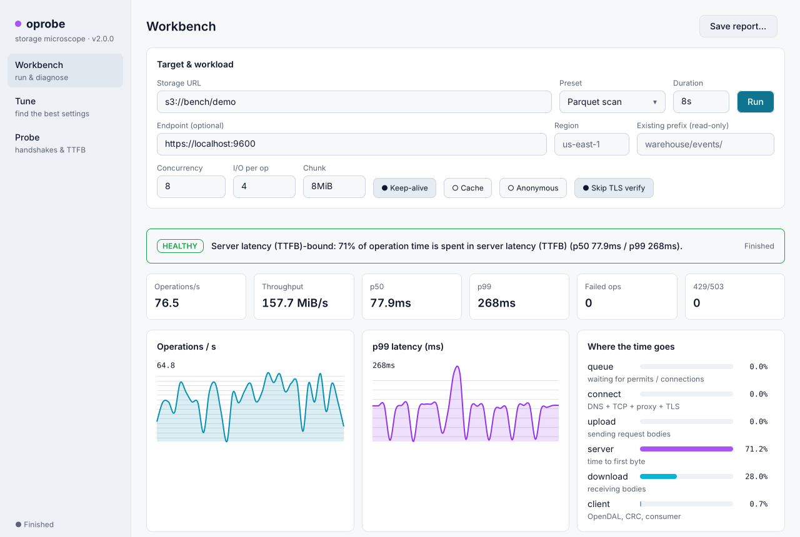

# oprobe

**看清对象存储客户端发出的每一个请求，知道时间和钱花在哪里，以及该改什么。**

oprobe 通过 [Apache OpenDAL](https://opendal.apache.org/) 对 S3、GCS、Azure Blob、R2、OSS、COS、B2、MinIO 或本地存储
施加真实负载，并追踪**每一个后端请求**：排队、新连接的 DNS/TCP/代理/TLS、发送、等待首字节、传输、等待你的代码消费。
它给出发现的问题的原因、证据、建议以及验证方法。每次运行都保存为一个 `.oprobe` 文件，可以重新打开、对比、导出，
或交给智能体分析。

它为人（终端、原生应用、单文件 HTML 报告）、为 CI（GitHub Action、退出码、Markdown/JUnit）、也为智能体
（处处可用 JSON、事件流、MCP 服务器）而设计。

[English](README.md) · [快速上手](docs/getting-started.md) · [概念](docs/concepts.md) · [命令参考](docs/cli.md) ·
[阅读报告](docs/reading-the-report.md) · [指标](docs/metrics.md) · [负载](docs/workloads.md) · [CI](docs/ci.md) ·
[安装](docs/install.md) · [故障排查](docs/troubleshooting.md)

（详细文档为英文。）

## 60 秒上手

```bash
# 1. 安装（macOS / Linux；Windows 与安装包见 docs/install.md）
curl -fsSL https://github.com/hxddh/oprobe/releases/latest/download/install.sh | sh

# 2. 不需要账号、不需要参数，看看 oprobe 能发现什么
oprobe demo

# 3. 你的存储桶
oprobe target add prod s3://my-bucket/oprobe --region eu-west-1
oprobe run prod
```

`oprobe demo` 在进程内启动一个本地 S3 实验服务器：并发超过 24 个请求时返回限流，每 40 个请求有 1 个慢请求；
用 32 个 worker 测量 8 秒，然后一步步解释它的发现。不带目标运行 `oprobe run` 时会询问要测什么：演示、本机发现的
AWS profile、Google 凭据、Azure 环境变量，或者一个 URL，并把选择保存为命名目标。

默认输出最多 20 行、不超过 80 列：结论、最重要的发现（原因 · 证据 · 建议 · 下一条命令）、关键数字，以及完整报告的位置。

## 深入查看

| | |
|---|---|
| `oprobe runs show last` | 终端里的完整报告（80 列；`--detail` 查看全部）。 |
| `oprobe runs show last -o html > report.html` | 一个自包含的 HTML 文件：带真实坐标轴的图表、延迟热力图、最慢操作的请求瀑布图、可筛选的全部请求表。离线可用，支持亮/暗色，可打印。 |
| `oprobe runs open last` | 在原生应用中打开这次运行。 |
| `oprobe compare base last` | 两次运行之间的回归门禁（回归时退出码 3）。 |
| `oprobe tune prod` | 不触发限流的最佳客户端配置，输出 profile 与 Rust/Python 代码。 |
| `oprobe runs list` | 所有保存的运行：时间、结论、ops/s、p99、成本。 |


## 应用

不带参数运行 `oprobe`：有显示器时打开原生窗口（macOS 上为 AppKit，Windows 上为 Win32/Direct2D，Linux 上为 GTK 4），
否则在终端中打开同样的工作台（`oprobe top`，SSH 下也可用）。[更多 →](docs/app.md)



## 它回答的问题

| 问题 | 方法 |
|---|---|
| 是网络、服务器还是我的客户端？ | 根据真实请求时间线，把每个操作的耗时拆分为 排队 / 连接 / 上传 / 服务器 / 下载 / 重试 / 客户端。 |
| 为什么 p99 比 p50 差这么多？ | 最慢的操作保留每个请求的各阶段耗时、连接（冷/热）、状态码和请求 ID，以及卡住时采集的异步调用栈。 |
| 是限流吗？ | 429/503 计数、Retry-After、重试退避作为独立份额，以及开始限流的并发度（`oprobe tune`）。 |
| 连接复用了吗？TLS 慢吗？ | 每次建连的 DNS/TCP/代理/TLS 耗时、复用率、峰值在途请求数、按远端地址统计。 |
| 我是否在为用不到的字节付费？ | 读放大、范围合并导致的多读、每个操作的请求数。 |
| 要花多少钱？ | 实测请求构成 × 各云厂商价格表，以及失败请求和多读造成的浪费。 |
| 我的改动让存储 I/O 变差了吗？ | `oprobe compare` 或 GitHub Action：噪声阈值、配置差异、Markdown + JUnit。 |

## 在 CI 中

```yaml
- uses: hxddh/oprobe@v3
  with:
    target: s3://ci-bucket/oprobe
    preset: small-files
    baseline: main
```

该 Action 安装固定版本的 oprobe、运行、与基线对比、上传 `.oprobe` 文件和 HTML 报告、维护一条置顶的 PR 评论，
并在回归时失败。[CI 指南 →](docs/ci.md)

## 面向智能体

所有命令都支持 `-o json` 输出单个 JSON 文档、`-o ndjson` 输出事件流；错误带稳定的错误码和退出码；`oprobe schema`
输出 JSON Schema；`oprobe mcp` 是一个 MCP 服务器（默认只读，`--allow-write` 才允许写入）。参见
[docs/agents.md](docs/agents.md) 和 [llms.txt](llms.txt)。

## 安装

| 平台 | |
|---|---|
| macOS / Linux | `curl -fsSL https://github.com/hxddh/oprobe/releases/latest/download/install.sh \| sh` |
| Windows | `winget install hxddh.oprobe`、`.msi`，或 `irm https://github.com/hxddh/oprobe/releases/latest/download/install.ps1 \| iex` |
| Homebrew | 每个版本附带 `oprobe.rb`（命令行）和 `oprobe.cask.rb`（应用）— [docs/install.md](docs/install.md#homebrew) |
| Debian / Ubuntu、Fedora / RHEL | 发布页上的 `.deb` / `.rpm` |
| Rust | `cargo install oprobe --locked`（Linux 上加 `--features gui` 获得窗口） |

macOS 和 Windows 安装包**没有代码签名**（没有证书）：首次打开需要确认一次 —
[方法](docs/install.md#first-open-of-unsigned-packages)。每个文件都在 `SHA256SUMS` 中有 SHA-256，并带有签名的
SLSA 构建来源证明（`gh attestation verify`）。用 `oprobe self-update`（或你的包管理器）更新。

oprobe 不发送任何遥测数据。它只连接你指定的存储，以及在运行 `oprobe self-update` 时连接 GitHub。
[隐私 →](docs/privacy.md)

## 许可证

Apache-2.0
