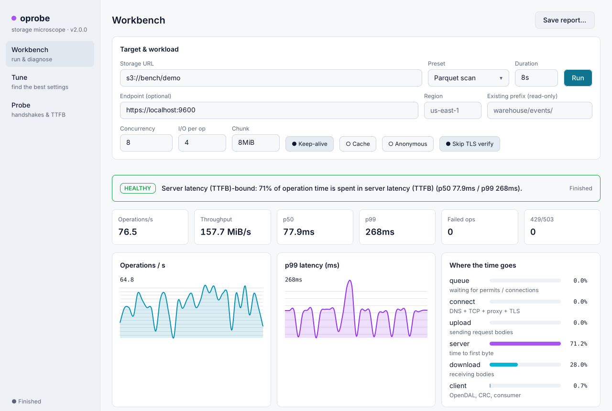
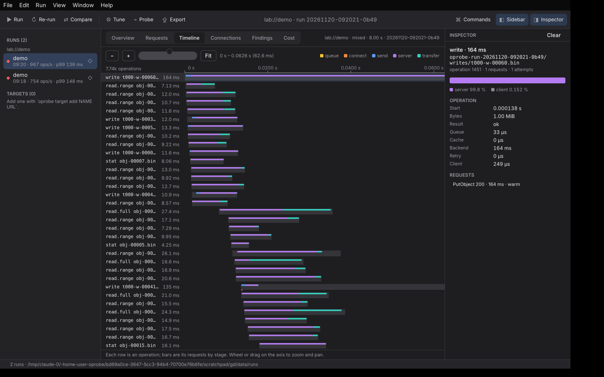

# Desktop & terminal app

`oprobe-app` is oprobe's graphical front end, built with [Native Shell (NSH)](https://github.com/longbridge/nsh):
one Rust UI rendered with each platform's own toolkit, and the same UI on a terminal grid.

| Platform | Drawn with | Package |
|---|---|---|
| macOS 14+ | AppKit, Core Animation, CoreText | `oprobe-app-<ver>-macos-universal.dmg` (Apple Silicon + Intel `oprobe.app`) |
| Windows 10 1809+ | Win32, Direct2D, DirectWrite | `oprobe-app-<ver>-x64.msi` (Start menu shortcut), or the portable `.zip` |
| Linux (GTK 4.14+) | GTK 4, Pango | `oprobe-app-<ver>-x86_64-unknown-linux-gnu.tar.gz` (`install.sh`, `.desktop` entry, icon) |
| Any terminal | NSH terminal backend | `oprobe-app --tui` or `oprobe top` — same UI, keyboard and mouse |



## What it does

- **Workbench** — choose a target (`s3://…`, `gcs://…`, `memory://`, …), a preset, duration and client knobs, then
  *Run*. While it runs: verdict, KPIs, live operations/s and p99 charts and where the time goes. When it finishes:
  per-operation and per-API tables, connections, findings, the projected cost per provider, and the **slowest
  operation as a waterfall** — one track per backend request, colored by stage, with the async call stack captured
  while it was stuck. *Save report…* writes the same JSON (`oprobe diff`-compatible) and Markdown as the CLI.
- **Tune** — runs the throttle-aware tuner against the target, shows every trial as it completes, and offers the
  winner: *Apply to workbench*, *Save profile…* (`oprobe run --profile`), *Save Rust code…*.
- **Probe** — DNS / TCP / proxy CONNECT / TLS and cold vs warm TTFB of an endpoint, with clock skew.



All measurement logic is the `oprobe` library — the app and the CLI produce identical numbers. Test data is cleaned up when a run ends or is stopped.

## Launching

```bash
oprobe-app                                     # opens the workbench
oprobe-app s3://my-bucket/oprobe --preset parquet -d 30s
oprobe-app s3://bench/demo --endpoint https://localhost:9000 --insecure
oprobe-app --tui                               # the same UI in this terminal
```

Credentials come from the usual environment (`AWS_*`, `~/.aws`, `GOOGLE_APPLICATION_CREDENTIALS`, …), proxies from
`HTTPS_PROXY` / `NO_PROXY`, exactly as for the CLI.

## One UI toolkit: NSH

The window and the terminal UI are the same NSH app; `oprobe top` simply starts `oprobe-app --tui` (found next to the
`oprobe` binary or on `PATH`) with the target and options you pass:

```bash
oprobe top s3://my-bucket/oprobe --preset parquet -c 32     # == oprobe-app --tui s3://... --preset parquet -c 32
```

The architecture is deliberately two-layered: **OpenDAL + oprobe's own pure-Rust transport** (the `oprobe` crate:
measurement, tuner, reports, CLI) and **NSH** (the `oprobe-app` crate: every UI). Nothing else is a framework.
NSH is built with only what the app uses (`plot`); its JS engine, WebGPU shaders, network loader, updater, math,
crypto and media features are off. `oprobe-app` needs Rust ≥ 1.97 and, on Linux, GTK 4; NSH's terminal backend
currently always compiles its syntax highlighter (a small C regex library), which is why the UI lives in its own crate
and `cargo install oprobe` stays pure Rust.

## Building from source

```bash
cargo install oprobe-app     # from crates.io (Rust ≥ 1.97; Linux: GTK 4 dev package)
cd app
cargo run                    # desktop window
cargo run -- --tui           # terminal
cargo test                   # headless UI flows on the real NSH engine
```

Linux build dependency (Debian/Ubuntu 24.04): `sudo apt install libgtk-4-dev`.

With the [NSH CLI](https://nsh.dev/docs/installation) you can also use `nsh run`, `nsh run --target tui` and
`nsh package` from `app/` (`nsh.json` describes the app).
