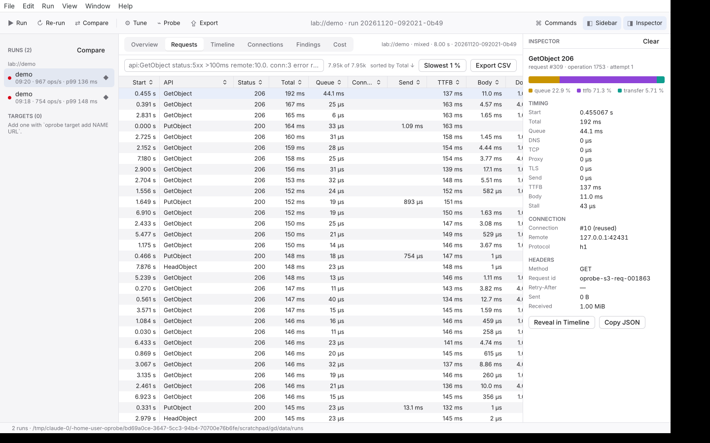

# Workbench: window and terminal

`oprobe` has one interactive workbench, built with [Native Shell (NSH)](https://github.com/longbridge/nsh). It is the
same app in a native window and in any terminal:

```bash
oprobe                                         # opens the workbench (window if there is a display, else terminal)
oprobe gui s3://my-bucket/oprobe --preset parquet -d 30s    # window
oprobe top s3://my-bucket/oprobe --preset parquet -d 30s    # this terminal (also over SSH)
oprobe top s3://bench/demo --endpoint https://localhost:9000 --insecure
```

| Where | Drawn with | Comes with |
|---|---|---|
| macOS 14+ | AppKit, Core Animation, CoreText | every macOS build: `.pkg`, `.dmg` (`oprobe.app`), archives, Homebrew |
| Windows 10 1809+ | Win32, Direct2D, DirectWrite | every Windows build: `.msi` (Start menu shortcut), `.zip`, Scoop |
| Linux (GTK 4.14+) | GTK 4, Pango | `oprobe-desktop-<ver>-x86_64-unknown-linux-gnu.tar.gz`, or `cargo install oprobe --features gui` |
| Any terminal | NSH terminal backend | every build, including the static Linux binaries, `.deb`, `.rpm` and `cargo install oprobe` |

Linux packages for servers (`.deb`, `.rpm`, static musl archives) are built without the window so they need no GTK;
`oprobe top` is always there.


## What it does

The window has three panes:

- **Sidebar**: the run in progress (pinned), then every saved run grouped by target, your targets and baselines.
- **Run inspector**: tabs for the selected run.
  - **Overview**: the verdict, the top findings (each with *Verify*, which runs the finding's verification command
    as a new run), key numbers, where operation time goes (including retry backoff), and live charts with real
    axes. Latency can be drawn on a log scale; nothing is smoothed.
  - **Requests**: every backend request in a table that stays fast at 100 000 rows. Sort, resize, filter
    (`api:GetObject status:5xx >100ms remote:10.0. conn:3 retry cold t:2..5`), copy as JSON, reveal in the
    timeline, export CSV.
  - **Timeline**: operations and their requests as a waterfall, coloured by stage, with zoom and pan.
  - **Connections**: per remote IP and per connection: reuse, dial phases, TLS handshake kind, TCP RTT and
    retransmits.
  - **Findings**, **Cost**.
- **Inspector**: everything about the selected request or operation (stages, TLS, TCP, retries, request id), or
  *what is different* about a selection. Drag across the heatmap to ask which attributes (API, cold connections,
  a remote IP, a stage…) are over-represented among those requests.

The toolbar has **New run** (a sheet with recent targets, preset, duration, concurrency and advanced options),
Run/Stop, Re-run, **Compare** (two runs: overlaid charts, deltas with significance, configuration and findings
differences), **Tune**, **Probe** and Export. The command palette (⌘K / Ctrl+K) reaches every action, and the app menus
carry the usual shortcuts (⌘N new run, ⌘O open, ⌘R run, ⌘. stop, ⌘1–6 tabs, ⌘, settings; Ctrl on Windows and Linux).
With no runs yet, the app opens on a welcome view: try the demo (`lab://demo`), connect a bucket (detected AWS,
GCP and Azure credentials are offered), or open a run file.




The terminal workbench (`oprobe top`) has the same model, driven by the keyboard: `r` run, `s` stop, `n` new run,
`1`–`6` tabs, `/` filter, `j`/`k` move, Enter inspect, `c` compare, `?` help, `q` quit. It fits 80×24 and works
without colour.

The workbench drives the same engine as the CLI with the same defaults (preset `parquet`, 10 s window, 2 s warmup;
the tuner's 5 s trials, 1 s trial warmup, at most 24 trials, 5 s cooldown), so the numbers are identical. Test data is
cleaned up when a run ends or is stopped. Credentials come from the usual environment (`AWS_*`, `~/.aws`,
`GOOGLE_APPLICATION_CREDENTIALS`, …), proxies from `HTTPS_PROXY` / `NO_PROXY` (or the *Proxy* field / `--proxy`),
exactly as for the CLI. `top` and `gui` also take `--region`, `--ca-cert`, `--insecure` and `--proxy`.

**Quitting mid-run** (Ctrl+C in the terminal, closing the window) stops the job and waits — up to 30 s — until its test
data is removed; the workbench shows *Stopping and cleaning up test data…* meanwhile. A second Ctrl+C quits at once
(`oprobe cleanup` removes what is left). *Apply to workbench* applies the tuner's winning configuration; the
workbench's own results are left untouched by tuning.

`oprobe top` needs an interactive terminal (use `oprobe run` in scripts); it honors `--color never` and `NO_COLOR`.
`oprobe gui` without a display (no `DISPLAY` / `WAYLAND_DISPLAY` on Linux, or an SSH session) says so and exits with
code 2 — use `oprobe top` there. When the window cannot start, the reason is also written to a log file, since
stderr is invisible when launched from Finder or Explorer: `~/Library/Logs/oprobe.log` (macOS),
`%LOCALAPPDATA%\oprobe\oprobe.log` (Windows), `$XDG_STATE_HOME/oprobe/oprobe.log` or
`~/.local/state/oprobe/oprobe.log` (Linux). Saving from the terminal writes to the working directory and never
replaces an existing file (`report-1.json`, …).

## Opening saved runs

Every run, from the CLI or the app, is saved as a `.oprobe` file. Open one in the app with
`oprobe runs open RUNREF` (it starts `oprobe gui --open FILE`), or start the terminal workbench on it with
`oprobe top --open FILE`.

## Unsigned desktop builds

The macOS `.dmg`/`.pkg` and the Windows `.msi` are not signed with a developer certificate yet. macOS 15+: open the
app once, then *System Settings → Privacy & Security → Open Anyway*; macOS 14: right-click `oprobe.app` → *Open*; or
`xattr -dr com.apple.quarantine /Applications/oprobe.app`. Windows: in the SmartScreen prompt choose *More info* →
*Run anyway*. Installing through Homebrew, Scoop or `cargo install` avoids both prompts.

## Building from source

```bash
cargo install oprobe                    # CLI + terminal workbench (Rust ≥ 1.97, a C compiler)
cargo install oprobe --features gui     # + native window (Linux: sudo apt install libgtk-4-dev)

cargo run --features gui -- gui         # from a checkout
cargo test                              # includes headless UI flows on the real NSH engine
```

NSH is built with only what the workbench uses (`plot`); its JS engine, WebGPU shaders, network loader, updater,
math, crypto and media features are off.
